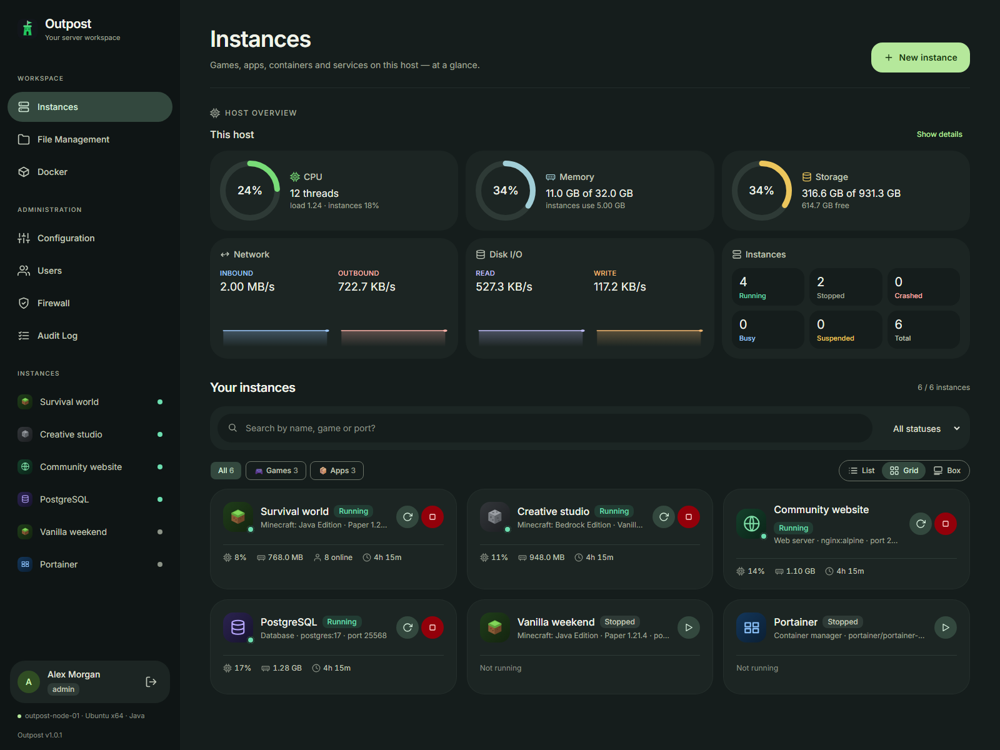
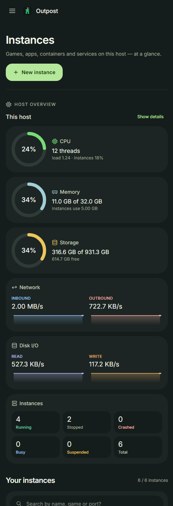
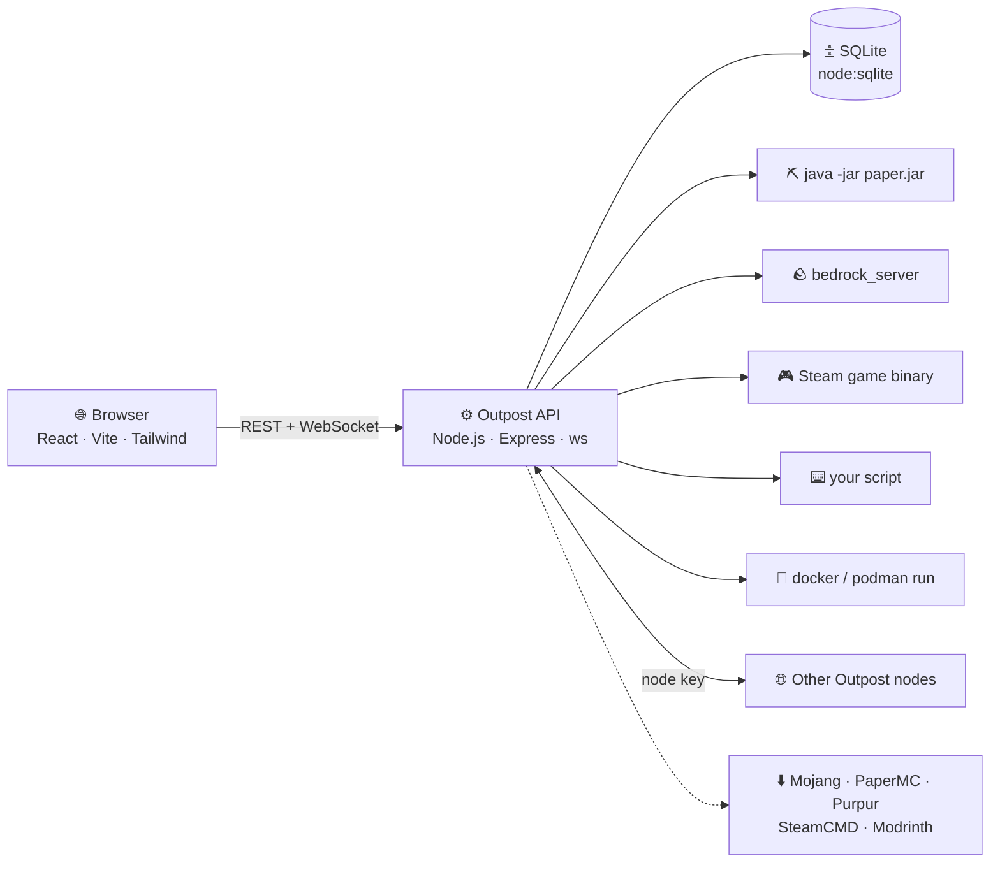

<p align="center">
  
</p>

<p align="center">
  
  
  
  
  
  
</p>

<h3 align="center">Your self-hosted workspace for games, apps and containers.</h3>

<p align="center">
  Deploy instances, watch host health, and manage day-to-day operations from one browser tab.<br>
  Minecraft and Steam servers &middot; Docker and Podman &middot; Web apps and databases &middot; Custom processes
</p>

<p align="center">
  <a href="#overview">Overview</a> &middot;
  <a href="#screenshots">Screenshots</a> &middot;
  <a href="#-quick-start">Quick start</a> &middot;
  <a href="#features">Features</a> &middot;
  <a href="#-what-you-can-run">Supported workloads</a> &middot;
  <a href="#-guides">Guides</a> &middot;
  <a href="#%EF%B8%8F-operations">Operations</a>
</p>

## Overview

Outpost is a self-hosted control panel for running game servers, applications, containers and custom processes on your own hardware. Create an instance from the catalog or configure it yourself, then manage its console, files, updates and backups in the same place.

The redesigned interface takes inspiration from **Material Design 3 Expressive**: soft tonal surfaces, clear headings, grouped navigation and prominent actions. The dashboard brings host CPU, memory, storage and throughput together with instance status. Search by name, game or port, filter by category and running state, and switch between list, grid and box views to suit your setup.

Built with **React, TypeScript and Node.js**, Outpost uses built-in SQLite for panel data. Start with a single host, assign access to other users as needed, and link additional Outpost hosts to transfer instances. Container workloads require Docker or Podman; game runtimes depend on the platform you choose.

Admins can fine-tune each assigned user's access under **Users ? Edit user ? Instance access ? Individual configuration items**. Set general server settings and individual `server.properties` keys to **Inherit**, **Allow**, or **Deny**. Allow grants that item independently of Edit configuration; Deny locks it. Any denial also disables broader actions that could overwrite protected settings, including raw file/SFTP writes, console commands, restores, launch edits, plugins, updates and player actions. Existing scheduled jobs and programs already running on the server keep their own authority. Host-wide settings remain admin-only.

The admin sidebar also includes **Host Console** for interactive host-wide shell sessions. Choose the service account, root, or a named OS user on Unix; Windows uses the service account's PowerShell. See the [host console guide](docs/host-console.md). Planned AMP-inspired features are tracked in [roadmap.md](roadmap.md).

Each instance's **Configuration → Backup storage** can point snapshots, scheduled/pre-update backups, World Rewind and file undo copies to an external drive or another partition. Existing archives can be copied before switching; originals are kept. See the [backup storage guide](docs/backup-storage.md).

The sidebar's **Storage** page manages Linux disks, filesystem formatting, mounting, UUID-based boot mounts in `fstab`, signature wiping and basic GPT initialization. Administrators have access by default; other users need explicit permissions under Users. See the [storage setup and permissions guide](docs/storage.md).

Storage also includes LUKS2 creation/unlocking/locking and passphrase changes, LVM PV/VG/LV creation and renaming, thin pools/snapshots, partition growth and supported ext4 shrinking. See the [advanced storage guide](docs/advanced-storage.md) for resize ordering, permissions and helper upgrades.

Admins can also discover and manage containers created by Docker CLI/Compose/Portainer and VMs created in Cockpit/virt-manager/virsh. The Docker and Virtual Machines pages show all workloads on their selected engine/libvirt connection, including stopped ones, without importing or recreating them. See [external workload discovery](docs/external-workloads.md).

## Screenshots

Administrators can also manage QEMU/KVM guests from **Virtual Machines** and **Libvirt Configuration** in the sidebar: start/stop/pause guests, configure CPU/memory/autostart, import or edit domain XML, and open read-only previews or interactive browser VNC/SPICE consoles. Includes offline snapshots, directory storage pools, virtual disks, NAT/isolated/bridged networks, migration jobs and per-user VM permissions. Supports local libvirt and remote SSH connections. See the [libvirt setup guide](docs/libvirt.md) and [roadmap and comparison with AMP and other panels](roadmap.md).

### Desktop workspace



Host health at the top, searchable instances below, and workspace and administration tools in the sidebar.

<details>
<summary><b>Mobile dashboard</b></summary>

<p align="center">
  
</p>

The dashboard adapts to smaller screens with stacked cards and a navigation drawer.

</details>

*Actual UI captures using illustrative host metrics and sample instances. No live server or account data is shown.*

---

## 🚀 Quick start

> [!TIP]
> On **Debian/Ubuntu, Arch or Fedora**, `./install.sh` does all of this for you — Node.js, Java, the **bubblewrap** sandbox, a **container engine** for Docker/Portainer/app instances (enabled with systemd), the build, a health check, and an optional `outpost.service`.
>
> ```bash
> ./install.sh                    # asks as it goes (container engine: Docker by default)
> ./install.sh --engine=podman    # rootless Podman instead — no root daemon, no docker group
> ./install.sh -y                 # accept every default
> ./install.sh --no-containers    # skip the container engine
> ./install.sh --wine             # also install Wine + winetricks (Windows-only game servers)
> ```
>
> With **Docker** it installs `docker.io` / `moby-engine` / `docker`, enables `docker.service` + `docker.socket` and adds you to the `docker` group (root-equivalent — log out and back in afterwards). With **Podman** it installs `podman`, enables your user's `podman.socket` (what Portainer talks to) and turns on lingering so it runs without a login. Either way it can pre-download the Portainer image.

```bash
git clone <this-repo-url> Outpost && cd Outpost
npm run setup        # 📦 install dependencies
npm run build        # 🏗️ build API + UI
npm start            # ▶️ http://localhost:8642
```

Open **http://localhost:8642** — the first visit walks you through creating the admin account. 🎉

| You need | For |
|---|---|
| 🟩 **Node.js 22.5+** (24 recommended) | the panel itself |
| ☕ **Java 21+** | Vanilla / Paper / Purpur / Spigot servers |
| 🛠️ **JDK + git** | building Spigot from source |
| 🧱 **32-bit libraries** (Linux) | Steam-based servers — [see Guides → Steam](#-guides) |
| 🍷 **Wine** (Linux, optional) | Windows-only servers like Black Ops III — `./install.sh --wine` |

---

## Features

| Area | What you can do |
|---|---|
| **Deploy and organize** | Create games, catalog apps, Docker/Podman containers and custom processes. Use templates and configure ports, environment variables, launch commands and resource limits. |
| **Monitor and control** | Check host and instance metrics, start or stop instances, follow live console output, send commands, and browse retained console history. |
| **Manage games** | Install Minecraft loaders, plugins and mods; manage supported Steam Workshop content; configure players, maps and game-specific settings. |
| **Protect your data** | Create manual or scheduled snapshots, restore individual files, configure off-site backups, or export the whole environment. |
| **Automate operations** | Schedule commands and restarts, configure automatic game updates and crash recovery, and send Discord or webhook notifications. |
| **Share access** | Assign roles and per-instance permissions, set creation limits, enable authenticator-based two-factor sign-in, and review the audit log. |
| **Manage the host** | Browse files, configure SFTP and database hosts, manage supported host firewalls and UPnP forwarding, and transfer instances between linked hosts. |
| **Make it yours** | Use the Material-inspired dark theme or select Windows XP, Vista / 7, Frutiger Aero or Minecraft themes. Reduce effects when you prefer less motion. |

Platform-specific capabilities and setup requirements are covered in the guides below.

---

## 🧰 What you can run

Click **New instance** and pick what to create:

| | Option | What you get | Who |
|:-:|---|---|---|
| 📦 | **App from the catalog** | One-click web apps, databases, media servers and tools (below) — pre-wired ports, folders and a web UI link | admins · users with container access |
| 🧭 | **Portainer** | A full container-management UI for this host, set up in one click | admins · users with Portainer access |
| 🐳 | **Docker container** | Any image from Docker Hub, GHCR or your own registry | admins · users with *any image* access |
| 🎮 | **Game server** | Minecraft Java/Bedrock or Steam dedicated servers — installed, updated and modded for you | anyone allowed to create |
| ⌨️ | **Custom process** | Any Linux binary or shell script with your own start/stop/restart commands | admins |

The Instances page groups everything with **🎮 Games · 📦 Apps · 🐳 Containers · ⌨️ Custom** filters, and anything with a web interface gets an **Open web UI** button.

### 📦 App catalog

| Section | Apps |
|---|---|
| 🧭 Platform tools | **Portainer** (container management) · **Uptime Kuma** (uptime monitoring & status pages) |
| 🌐 Web & apps | **Nginx** (static sites from the instance's `html` folder) · **Vaultwarden** (Bitwarden-compatible passwords) |
| 🗄️ Databases | **PostgreSQL** · **MariaDB** · **Redis** |
| 🎞️ Media & files | **Jellyfin** (media streaming) · **File Browser** (share files) |
| 🎮 Games | Minecraft Java & Bedrock, Valheim, Palworld, Counter-Strike 2 (as containers) |

Every template is just a starting point — change the image, ports, environment, folders and limits before creating, or later under **Configuration → Container**.

### 🎮 Game servers

| | Game | Plugins / mods | Default port |
|:-:|---|---|---|
| ⛏️ | **Minecraft: Java** — Paper · Purpur · Spigot | 🧩 Bukkit plugins — Modrinth + upload | `25565/tcp` |
| ⛏️ | **Minecraft: Java** — Vanilla | 📦 Data packs — Modrinth + upload | `25565/tcp` |
| 🧵 | **Minecraft: Java** — Fabric · Quilt · Forge · NeoForge | 🧩 Mods — Modrinth / CurseForge + upload | `25565/tcp` |
| 🧪 | **Minecraft: Java** — Mohist (Forge + Bukkit) · SpongeForge | 🧩 Forge mods (+ Bukkit / Sponge plugins) | `25565/tcp` |
| 🔀 | **Minecraft proxies** — Velocity · Waterfall · BungeeCord | 🧩 Proxy plugins — Modrinth + upload | `25577/tcp` |
| 📦 | **Modrinth modpacks** (.mrpack) — any of the above loaders | 🧩 The pack’s mods and configs | `25565/tcp` |
| 🪨 | **Minecraft: Bedrock** | 🎒 `.mcpack` / `.mcaddon`, auto-activated per world | `19132/udp` |
| 🪖 | **Valheim** | 🔌 BepInEx plugins (`.dll` / `.zip`) | `2456/udp` |
| 🐾 | **Palworld** | 📦 `.pak` mods | `8211/udp` |
| 🔫 | **Counter-Strike 2, CS:GO, Source, 1.6 & Condition Zero** | — | `27015/udp` |
| 🎩 | **Team Fortress 2** | — | `27015/udp` |
| ⚡ | **Quake III Arena (ioquake3) & Quake Live** | — | `27960/udp` |
| 🛠️ | **Garry's Mod** | 🧰 Workshop addons & collections, uploaded `.gma` / folder addons / gamemodes / maps, CS:S content | `27015/udp` |
| 🛠️ | **Left 4 Dead 2, HL2:DM, DoD:S, Half-Life DM, TFC** | — | `27015/udp` |
| 🦖 | **ARK: Survival Evolved** | 🧰 Steam Workshop mods (load order) | `7777/udp` |
| 🪖 | **Arma 3** | 🧰 Steam Workshop mods + keys | `2302/udp` |
| 🔫 | **Call of Duty: Black Ops III** *(Wine on Linux)* | 🧰 Steam Workshop maps & mods | `27017/udp` |
| 🏝️ | **Rust, 7 Days to Die, Satisfactory, Unturned** | — | game default |
| 🧟 | **Project Zomboid** | 🧰 Steam Workshop items, written into its `.ini` | `16261/udp` |
| 🌳 | **Terraria** | — *(the vanilla server has no mod loader)* | `7777/tcp` |
| 🎯 | **Any Steam App ID** — CS2, TF2, Rust, ARK, Quake Live… | — | your choice |

Known titles and app types get their own emblem, and running instances wear a live 🟢 dot.

---

## 📚 Guides

<details>
<summary><h3>🍷 Wine — Windows-only servers on Linux</h3></summary>

Some dedicated servers only ship for Windows (Call of Duty: Black Ops III, and many older games). On Linux, Outpost runs them through **Wine**:

- Install it with `./install.sh --wine` (Wine, Xvfb, winetricks and cabextract for your distro), or your package manager.
- **Automatic:** Windows-only presets and any `.exe` / `.bat` executable run through Wine. For a Steam App ID without a Linux server, tick **"Windows-only server"** when creating it — steamcmd then fetches the Windows build.
- **Per instance**, the **Wine** tab sets:
  - **Run through Wine:** automatic, always or never.
  - **Windows version** (XP → 11), applied before the next start.
  - **Prefix architecture:** 64-bit, or 32-bit only.
  - **DLL overrides** (`WINEDLLOVERRIDES`), **debug channels** (`WINEDEBUG`), **esync / fsync**.
  - A **virtual screen** (Xvfb, with its size) for servers that open a window.
  - Admins can point an instance at a specific Wine build (e.g. `/opt/wine-staging/bin/wine`).
- **Dependencies:** pick winetricks verbs (Visual C++ runtimes, .NET, DirectX, XACT, PhysX…) or type your own. You can also run an `.exe` / `.msi` installer that's in the instance folder. Both run inside the instance's sandbox and log to the console. If winetricks isn't installed, Outpost downloads it the first time.
- **Isolated:** each instance has its own prefix in `<instance>/.wine`, so games never share registry or installs and backups include it. It's set up on the first start (about a minute), or from **Wine → Set up now**. **Reset prefix** starts it fresh.

</details>

<details>
<summary><h3>☕ Java versions</h3></summary>

Minecraft versions need different Java releases (1.16 and older: Java 8 · 1.17: 16 · 1.18–1.20.4: 17 · 1.20.5+: 21 · newer: what Mojang's metadata says).

- **Configuration → Java runtimes** lists every Java on the host and installs Eclipse Temurin in one click. Downloaded runtimes go in `data/runtimes/<version>`.
- Each Java instance automatically starts with the version its Minecraft version needs. To pin one, use **Configuration → Launch → Java version** on the instance.
- If the right Java isn't installed, the console says so and Outpost uses the closest newer one (never a newer one for Java 8 versions).

</details>

<details>
<summary><h3>🎛️ RCON, automatic updates &amp; console history</h3></summary>

- **RCON console** (instance → Configuration): Source RCON for Source games, Minecraft, ARK and Palworld, and WebRCON for Rust.
  - Outpost switches it on in the game where it can: `server.properties` for Minecraft, launch arguments for Rust, Source games and ARK.
  - It can generate the password, and **Test connection** checks it works.
  - Tick **Send console commands through RCON** to route the Console box, player actions and stop commands over RCON.
- **Automatic updates** (instance → Update): Outpost checks on a schedule.
  - Steam servers compare the installed build with Steam's. Paper and Purpur look for new builds, and Bedrock for new releases.
  - When there's an update, Outpost warns players in-game ("restarting in 5 minutes…"), stops the server, takes a snapshot, updates, and starts it again.
  - **Only notify** sends a webhook instead. Vanilla only follows new Minecraft versions if you allow it.
- **Console log history** (instance → Console → **Log history**):
  - Every line is saved to `data/console-logs/<instance>/<date>.log`, and past days are gzipped.
  - Search, download or delete a day's log.
  - Retention defaults to 30 days and is set under Configuration → Console logs.

</details>

<details>
<summary><h3>🧵 Modded Minecraft</h3></summary>

Pick the server software when creating a Java instance:

| Software | What runs | Installed with |
|---|---|---|
| **Fabric** / **Quilt** | Fabric (Quilt also runs most Fabric) mods | Fabric's server launcher · Quilt's installer |
| **Forge** / **NeoForge** | Forge / NeoForge mods | Their installers (launched from `@libraries/…/unix_args.txt`) |
| **Mohist** | Forge mods **and** Bukkit plugins | Mohist's own jar (sets up libraries on first start) |
| **SpongeForge** | Forge mods + Sponge plugins | Forge at the version Sponge needs, plus SpongeForge in `mods/` |
| **Modpack from Modrinth…** | A whole `.mrpack` | The pack's server-side mods + configs, then the exact loader version it was built for |

- Each instance starts with the Java its Minecraft version needs (see **Java versions**). Installers run with it too.
- The **Mods** tab searches Modrinth (and CurseForge with an API key) for mods that match the loader and Minecraft version, installs them with one click, and lets you toggle or remove them.
- **Update** installs the newest loader build for the same Minecraft version, and your mods stay put. Modpack instances stay pinned to their pack version.
- On Windows hosts, keep the data folder path short (e.g. `C:\Outpost\data`): Forge-style servers nest libraries deep inside each instance and can hit Windows' 260-character path limit. Outpost warns about this at startup.

</details>

<details>
<summary><h3>📂 SFTP, ☁️ off-site backups &amp; 🗄️ databases</h3></summary>

**SFTP**
- An admin switches it on under Configuration → SFTP (default port 2022).
- Each user sets their own **SFTP password**, which is separate from the panel password so SFTP can't sidestep 2FA. SSH keys work too.
- The login name is `<user>.<first 8 characters of the instance id>`; each instance's File Management page shows it.
- A login only reaches that one instance's folder, with the same rights as in the panel ("View files" = read-only, "Edit files" = read/write). Logins and changes go to the audit log.

**Off-site backups**
- Configuration → Off-site backups adds destinations: AWS S3, Backblaze B2, Wasabi, Cloudflare R2, any S3-compatible storage, or another machine over SFTP.
- Every new snapshot (manual or scheduled) is copied to them. Large snapshots upload in parts.
- Each destination keeps the newest N copies per instance.
- On an instance's Backups tab, each snapshot shows where it's been copied. **Off-site copies** brings one back, ready to restore.

**Per-server databases**
- An admin adds a MySQL/MariaDB **database host** under Configuration → Databases. Use an account with `ALL PRIVILEGES … WITH GRANT OPTION`.
- On an instance's Configuration page, anyone with "Edit configuration" can create databases for its plugins.
- Each database gets its own user that can only reach it. Outpost shows the host, user, password and JDBC URL, and can rotate the password.
- Deleting the database (or the instance) drops it and its user.

</details>

<details>
<summary><h3>📏 Resource limits &amp; 🔑 API keys</h3></summary>

**Resource limits** (instance → Configuration, admins)
- **CPU:** percent of one core (200 = two cores).
- **Memory:** hard cap in MB.
- **Processes:** a cap on processes and threads.
- **Disk:** a cap in MB on the instance folder.
- **How they're enforced:**
  - On Linux, CPU, memory and processes are enforced by the kernel. The instance runs inside a systemd scope wrapped around its sandbox. This needs Outpost running as a systemd service with lingering on (install.sh sets that up), or as root.
  - Container instances get the same values as Docker/Podman limits.
  - Disk usage is checked every few minutes. Going over warns in the console and by webhook ("Disk limit reached"), blocks starts, uploads, editor saves and SFTP writes, and can also stop the server.

**API keys** (Configuration → API keys)
- Personal keys for scripts, bots and Discord integrations: `Authorization: Bearer opk_…`.
- A key acts as its owner, with the same role and instance permissions. It can be read-only and can expire.
- Only a hash is stored, so the key is shown once.
- Keys can't create keys or change passwords, 2FA or SFTP logins.
- The audit log notes which key made each change. Admins can see and revoke everyone's keys.

</details>

<details>
<summary><h3>📦 Server templates &amp; 🌐 status pages</h3></summary>

- **Export** any instance as a template file (instance → Configuration → Template). It holds:
  - game and version, memory, port, launch settings, container config, automatic updates, RCON
  - the config files you tick (text only, 256 KB each)

  Passwords, tokens, Steam logins and secret-looking config values are stripped.
- **Import** template files under Configuration → Server templates. Create from them with **New instance → From a template**.
- Templates can declare **variables** (`{{MOTD}}`, `{{MAX_PLAYERS}}`…), which are asked for when creating and filled into arguments, environment and files. Built-ins like `{{PORT}}` still resolve at launch.
- Account limits still apply when creating from a template: platforms, memory, number of instances, and custom processes being admin-only.
- **Public status page** (instance → Configuration): an unguessable link (`/status/<id>`) that shows, with no sign-in:
  - whether the server is up, its uptime, the address to join (with a copy button) and, for Minecraft, who's playing
  - plus an SVG badge for websites and Discord (`/api/public/status/<id>/badge.svg`)

  Nothing else about the instance is exposed. **New link** retires the old one.

</details>

<details>
<summary><h3>🧰 Steam Workshop</h3></summary>

Supported games have a **Workshop** tab. Paste item or collection links/IDs; Outpost looks each one up on Steam (title, size, preview) and rejects items that belong to another game. What happens next depends on the game:

| Game | How items get onto the server |
|---|---|
| 🧟 Project Zomboid | Written into `WorkshopItems=` / `Mods=` in the server's `.ini`. The server downloads them itself |
| 🦖 ARK | Passed as `?GameModIds=` with `-automanagedmods`; ARK downloads and updates them on start |
| 🛠️ Garry's Mod | Downloaded, unpacked into `garrysmod/addons`, and listed with `resource.AddWorkshop` so players get them too |
| 🪖 Arma 3 | Downloaded into `@<id>` folders (lower-cased on Linux), keys copied to `keys/`, loaded with `-mod=` |
| 🔫 Black Ops III | Maps go to `usermaps/<codename>`, mods to `mods/`. Pick the start map and active mod |

ARK, Arma 3 and Zomboid load mods top to bottom; use the arrows to reorder. Black Ops III and Arma 3 Workshop downloads need a Steam account that owns the game (stored on the panel, never sent to the browser).

</details>

<details>
<summary><h3>🚀 Custom servers &amp; launch settings</h3></summary>

**Custom instances** (admins only) run any Linux server binary or shell script. There's no download step: create it, upload your files in **File Management** (or point at an absolute path), and start it.

Every instance — custom or not — has a **Launch** card under **Configuration**, with a live preview of the exact command it will run:

| | Setting | What it does |
|:-:|---|---|
| 📄 | **Executable / jar** | Which binary, script or `.jar` starts (relative to the instance folder). |
| ☕ | **Java binary** | A specific `java` instead of the auto-detected one. *(admin)* |
| 🔤 | **Arguments** | Replaces the default arguments; quotes group words. |
| 🐚 | **Shell mode** | Runs through `/bin/sh -c` for pipes, `&&` and `$VARS`. *(admin, custom only)* |
| 📂 | **Working directory** | A subfolder to run in. |
| 🌱 | **Environment** | Extra variables for the process. |
| ✅ | **Ready pattern** | Output regex that marks the instance *running*. |
| 🛑 | **Stop by** | Console command(s), `SIGTERM`/`SIGINT`/`SIGQUIT`/`SIGHUP`, or a stop script *(admin)*. |
| 🔁 | **Restart by** | Stop → start, console command(s), or a restart script *(admin)*. |
| ⏱️ | **Force-stop after** | Seconds before a hung stop is killed (default 60). |

**Variables** work in the command, arguments, env values and scripts — and are exported to the process:

| Placeholder | Environment variable | Value |
|---|---|---|
| `{{PORT}}` | `SERVER_PORT` | the instance's port |
| `{{NAME}}` | `SERVER_NAME` | its name |
| `{{ID}}` | `SERVER_ID` | its internal id |
| `{{DIR}}` | `SERVER_DIR` | absolute path of its folder |
| `{{MIN_MEMORY}}` · `{{MAX_MEMORY}}` | `SERVER_MIN_MEMORY_MB` · `SERVER_MAX_MEMORY_MB` | memory settings (MB) |

> [!WARNING]
> A launch command can run **any program on the host** as the panel's user. Editing it needs the **Edit launch command** permission, which is never on by default — an admin grants it per user, per instance. Shell mode, absolute paths, a custom Java binary and stop/restart scripts stay admin-only.

</details>

<details>
<summary><h3>🧩 Plugins, data packs &amp; mods</h3></summary>

The **Manage → Plugins** page (called *Data Packs*, *Add-ons* or *Mods* where that fits) adapts to each game:

- **⛏️ Paper / Purpur / Spigot** — search Modrinth and install in one click (falling back to the newest build if your exact version isn't listed), or upload `.jar`s. Disabling renames to `.jar.disabled`.
- **🔀 Velocity / Waterfall / BungeeCord** — proxy plugins from Modrinth (Velocity's own catalog, or BungeeCord/Waterfall's), or uploaded `.jar`s. Bukkit plugins belong on the backend servers.
- **⛏️ Vanilla** — data packs from Modrinth or uploaded `.zip`s into `<world>/datapacks`; they load on restart or with `/reload`.
- **🪨 Bedrock** — upload `.mcpack`, `.mcaddon` (nested packs included) or `.zip`. Packs are unpacked into `behavior_packs`/`resource_packs` and **activated for the world**; toggling adds/removes them.
- **🪖 Valheim** — BepInEx plugins (`.dll`, or a Thunderstore-style `.zip` unpacked into its own folder). Upload *BepInExPack_Valheim* to the instance root once and Outpost loads it automatically on Linux.
- **🐾 Palworld** — `.pak` mods into `Pal/Content/Paks/~mods`.
- **🛠️ Garry's Mod** — the *Addons* page takes `.gma` addons, a `.zip` of a folder addon or a gamemode (e.g. straight from GitHub — unpacked and lowercased for Linux), and `.bsp` maps. Addons can be turned off without deleting them, and Workshop items show up read-only. The **Garry's Mod** tab sets the gamemode, map and slots (picked from what's installed), hostname, password, loading screen and server token, and can download and mount **Counter-Strike: Source content** for TTT and CS:S maps in one click.

</details>

<details>
<summary><h3>📸 Snapshots</h3></summary>

Under each instance's **Backup Schedule**:

- ➕ **Create snapshot** — optionally labelled, e.g. `before-1.21-update`.
- ⏰ **Schedule** — presets or any cron expression, keeping the last *N*.
- ♻️ **Restore all** — replaces the instance's files (stop the server first).
- 🔀 **Restore one file** — open a snapshot, pick a file, review a **line-by-line diff** against the live copy, then restore just that file (works while running).

</details>

<details>
<summary><h3>👥 Users &amp; permissions</h3></summary>

Roles set the defaults; each user can be assigned **any number of instances**, each with its own permission set.

| Permission | Allows | Moderator | Viewer |
|---|---|:-:|:-:|
| ⚡ Start / stop | start, stop, restart, kill, retry install | ✅ | — |
| ⌨️ Console commands | send commands | ✅ | — |
| 👀 View files | browse/download files and snapshot contents | ✅ | ✅ |
| ✏️ Edit files | edit, upload, rename, delete | ✅ | — |
| 📸 Create snapshots | create/delete snapshots, edit the schedule | ✅ | — |
| ♻️ Restore snapshots | whole snapshots or single files | ✅ | — |
| 🧩 Plugins | install/toggle/remove plugins, mods, packs | ✅ | — |
| 👤 Players | op, kick, ban, whitelist | ✅ | — |
| ⚙️ Configuration | instance settings and `server.properties` | ✅ | — |
| ⬆️ Update | update the server software | ✅ | — |
| 🚀 Edit launch command | change what runs | — | — |
| 🔌 UPnP port forwarding | open router ports to this host | — | — |

Admins can do everything. Every assigned user can see status, console output and the player list.

#### ➕ Creating instances &amp; ownership

Each user also has an **Instance creation** policy (Users → Edit), either the role's default or their own:

| | Moderator default | Viewer default | Custom per user |
|---|:-:|:-:|---|
| ➕ Can create instances | ✅ | — | on / off |
| 🎮 Allowed types | Java · Bedrock · Steam | — | any of Java · Bedrock · Steam |
| 🔢 Max instances owned | no limit | — | e.g. 3 |
| 🧠 Max memory per instance | no limit | — | e.g. 4096 MB |
| 🐳 Containers | — | — | none · 📦 catalog apps only · any image |
| 🧭 Portainer &amp; engine access | — | — | on / off |

- 👤 **Every new instance is owned by its creator**, who automatically gets full control of it (everything except *Edit launch command* and *UPnP*, which stay opt-in) and can delete it. Its header shows *You own this* / *Owner: …*.
- 🔁 **Admins can hand an instance to someone else** under its **Configuration → Owner**; the new owner gets owner access and it counts toward *their* limit.
- 🧾 Deleting a user keeps their instances (ownership simply clears).
- 🐳 **Container access is granted per user.** *Catalog apps only* lets them create the templates in **New instance → App from the catalog**, always with the catalog's image; *Any image* allows any container. Either way containers only see their own folder, and non-admins can't publish host ports below 1024 or the panel's own port. Owners can edit their container's settings within the same limits.
- 🧭 **Portainer & engine access** is a separate switch: it lets a user run Portainer (or any container manager) with the engine socket — control over every container on the host, and with rootful Docker effectively the host. Give it only to people you'd trust as admin.
- 🔒 Custom processes can only be created by admins.

</details>

<details>
<summary><h3>🛡️ Security &amp; isolation</h3></summary>

Every instance is kept to its own folder — on by default, managed under **Configuration → Security**:

| Layer | What it stops |
|---|---|
| 🛡️ **Process sandbox** (bubblewrap, Linux) | The game can only write inside its instance folder (plus a private `/tmp`). System folders are read-only; your home folder, other instances and the panel's database/session secret don't exist inside the sandbox. `HOME` (and Java's `user.home`) points at `<instance>/.home`. |
| 🔗 **Symlink-proof file access** | A server, plugin or script can create `ln -s / escape` in its folder — the panel refuses to follow links out of the instance for browsing, editing, uploads, plugins and snapshot restores (an escaping link can still be deleted). |
| 📤 **Safe uploads** | Uploaded file names are reduced to a plain name, so `../../file` can't land outside the folder. |
| 🧹 **Clean environment** | Instances never inherit the panel's environment variables — no `OUTPOST_*` secrets or credentials that happened to be exported. |
| 🐳 **Containers** | Docker instances only see their mounted folder, with memory, CPU and process limits and `no-new-privileges`. |

Graceful stops still work in the sandbox — signals go straight to the game (e.g. Valheim's SIGINT save). Steam games get `~/.steam/sdk64/steamclient.so` linked from their own folder. Each instance shows its status under **Configuration → Isolation**; an admin can opt a single instance out if it truly needs files elsewhere.

> [!NOTE]
> The sandbox needs **bubblewrap** (`bwrap`) — already present wherever Flatpak is installed; otherwise `sudo apt install bubblewrap` / `dnf install bubblewrap` / `pacman -S bubblewrap`. Without it (or on Windows/macOS) the other layers still apply, and the Security card says why the sandbox is unavailable.

</details>

<details>
<summary><h3>🧭 Portainer &amp; the app catalog</h3></summary>

**Portainer** is one click away: **New instance → Portainer**. Outpost runs `portainer/portainer-ce:lts` with its data in the instance folder, publishes `9443` (HTTPS UI) and `8000`, and adds an **Open web UI** button. Open it within 5 minutes to create Portainer's admin account, then pick the *local* environment.

Portainer manages the container engine itself, so it's the one template that mounts the engine's API socket (`/var/run/docker.sock` inside the container). That gives it control over **every container on the host** — keep it admin-only and behind your network.

> [!TIP]
> On **Podman**, the API socket isn't running by default. Enable it once — `systemctl --user enable --now podman.socket` — and the Docker page will show it as available. With Docker it's `/var/run/docker.sock`. Point `OUTPOST_ENGINE_SOCKET` elsewhere if yours lives somewhere unusual.

The other catalog apps work the same way: pick one, review its settings, create. A few need a value changed first (database passwords, Vaultwarden behind HTTPS) — the dialog says so.

</details>

<details>
<summary><h3>🐳 Docker instances</h3></summary>

The **Docker** page shows your container engine and only your container-backed instances. It works with **Docker** or **Podman** — Podman runs rootless with no daemon, which is the safest option.

- ➕ **New Docker instance** *(admin)* — pick a preset (⛏️ Minecraft Java · 🪨 Bedrock · 🪖 Valheim · 🐾 Palworld · 🎯 CS2) or any image, then set ports, environment variables, the mount path, a CPU limit and an optional command. The image is pulled immediately.
- 📦 **Only its own folder** — the instance folder is the single host folder mounted into the container (at `/data` by default). Memory limit = the instance's *Max memory*; plus a process limit and `no-new-privileges`.
- 🖥️ **Everything else works as usual** — live console with input, start/stop/restart (signals are passed into the container), auto-restart, snapshots, File Management, UPnP and **per-container CPU, memory, network and disk metrics**.
- ✏️ **Change settings later** under the instance's **Configuration → Container**; **Update** pulls the image tag again.
- 👤 **Run as the panel's user** keeps files the container writes editable from File Management (turn it off for images that must start as root).
- 📂 **Extra folders** — mount subfolders of the instance (e.g. `media` → `/media`); the container still can't see anything outside its instance.
- 🌐 **Web interface** — mark a published port as the app's UI to get an **Open web UI** button (custom processes can do the same under **Launch**).
- 🔌 **Engine socket** — opt-in, admin-only, for container managers like Portainer (see above).

> [!WARNING]
> Access to the Docker daemon is root-equivalent on most hosts. Admins decide per user who may run containers (catalog apps only or any image) and who may use Portainer — see **Users & permissions**. Prefer rootless Podman or rootless Docker.

Pin an engine with `OUTPOST_CONTAINER_ENGINE=docker` or `podman`.

</details>

<details>
<summary><h3>🔌 UPnP port forwarding</h3></summary>

Each instance has a **UPnP** tab that asks your router (via UPnP IGD) to forward ports to this machine — no router admin page needed.

- 📡 **Router card** — the router Outpost found, this host's LAN address and your public IP.
- 🔢 **Rules** — single ports or ranges (up to 256 per rule), TCP, UDP or both, mapped one-to-one (`27015–27020` → `27015–27020`, or shifted to another local range).
- ⚡ **Forward now / Remove forwarding** — apply or clear on demand, with a per-port result (✅ / ❌ and the router's reason).
- 🔁 **Forward automatically while running** — opens the ports when the instance starts and closes them when it stops.
- ⏳ **Leases** — 30 min to 24 h (renewed automatically), or permanent. A timed lease lets the router drop the forwarding on its own if the panel goes away.
- 🗒️ **Forwarded right now** — every UPnP mapping the router currently points at this machine.

> [!IMPORTANT]
> Forwarding exposes this machine to the internet, so it needs the **UPnP port forwarding** permission (never on by default). Non-admins can't forward ports below 1024 or the panel's own port.

> [!TIP]
> **Router not found?** Turn on UPnP in the router and keep the host on the same network (discovery doesn't cross VPNs or Docker bridge networks). Host firewalls often drop the router's replies — with firewalld:
> `sudo firewall-cmd --permanent --add-service=upnp-client && sudo firewall-cmd --reload`.
> You can also skip discovery by pointing `OUTPOST_UPNP_GATEWAY` at the router's description URL (e.g. `http://192.168.0.1:5000/rootDesc.xml`).

</details>

<details>
<summary><h3>♻️ Auto-restart</h3></summary>

In an instance's **Configuration → General → Automatic restart**:

| Policy | Restarts when the process… |
|---|---|
| ⛔ **Never** | — (default) |
| 💥 **Crashes or fails** | exits with an error code or is killed by a signal |
| 🔁 **Stops for any reason** | exits in any way the panel didn't ask for — including an in-game `stop` |

- ⏱️ **Wait before restarting** — seconds between the exit and the restart.
- 🔢 **Give up after** — consecutive attempts before stopping (`0` = keep going forever). A run of 10 minutes or more counts as healthy and resets the count.
- 🛑 Stopping from the panel never triggers a restart, and pressing **Stop** during the countdown cancels it. Suspending an instance cancels it too.

</details>

<details>
<summary><h3>🛑 Suspension &amp; 🌐 multiple nodes</h3></summary>

**🛑 Suspension** — in an instance's **Configuration** (admin): pick a reason and an optional note. The instance stops (gracefully, or killed immediately), can't be started, and its users see a *suspended* screen with the reason — in the panel and the API alike. Admins keep full access.

**🌐 Nodes** — under **Configuration → Nodes** every panel shows its *node key*. Add another Outpost host by URL + key, then transfer a stopped instance from its **Configuration** page; its files and settings stream across. Keep a stopped copy or remove the original afterwards.

> [!NOTE]
> Transfers move instances between hosts — they aren't automatic failover. Use HTTPS or a private network between nodes, since instance files travel over that connection.

</details>

<details>
<summary><h3>🎯 Steam-based servers</h3></summary>

Choose **Steam** when creating an instance, then a game:

| Game | App ID | Port | Notes |
|---|---|---|---|
| 🐾 Palworld | 2394010 | `8211/udp` | Doesn't reliably stop on a signal; force-stopped after a grace period (its autosave is kept). |
| 🧟 Project Zomboid | 380870 | `16261/udp` | Stops cleanly with `save` → `quit`. Saves, `.ini` files and logs go in `<instance>/Zomboid` (`-cachedir=`), not `~/Zomboid`. |
| 🪖 Valheim | 896660 | `2456/udp` | Stops with SIGINT — it only saves its world on SIGINT. |
| 🌳 Terraria | 105600 | `7777/tcp` | Fetched from terraria.org; started with `-autocreate`/`-world`. |
| 🔫 Counter-Strike 2 | 730 | `27015/udp` | ~35 GB. Mode, maps, presets, bots, server token and plugins are in the instance's **CS2** tab — see below. |
| 🔫 CS:GO (legacy) | 740 | `27015/udp` | Players join with CS2's `csgo_legacy` beta. |
| 🔫 Counter-Strike: Source | 232330 | `27015/udp` | Settings in `cstrike/cfg/server.cfg`. |
| 🔫 Counter-Strike 1.6 / Condition Zero | 90 | `27015/udp` | Half-Life Dedicated Server with the `cstrike` / `czero` mod; its download is flaky — run Update again if needed. |
| ⚡ Quake III Arena | — | `27960/udp` | ioquake3 engine + id's free point release, downloaded from ioquake3.org. Upload your own `baseq3/pak0.pk3`; settings in `baseq3/server.cfg`. |
| ⚡ Quake Live | 349090 | `27960/udp` | Linux hosts only. |
| 🛠️ Garry's Mod / L4D2 / HL2:DM / DoD:S | 4020 / 222860 / 232370 / 232290 | `27015/udp` | Source dedicated servers (`srcds`). |
| 🛠️ Half-Life DM / Team Fortress Classic | 90 | `27015/udp` | Half-Life Dedicated Server with the `valve` / `tfc` mod. |
| 🏝️ Rust | 258550 | `28015/udp` | ~10 GB, 8–12 GB RAM. |
| 🏝️ ARK: Survival Evolved | 376030 | `7777/udp` | ~20 GB; also forward query port 27015. |
| 🏝️ 7 Days to Die | 294420 | `26900/udp` | Port and settings live in `serverconfig.xml`. |
| 🏝️ Satisfactory | 1690800 | `7777/udp` | Claim the server from the game's Server Manager. |
| 🏝️ Unturned | 1110390 | `27015/udp` | Settings in `Servers/outpost/Server/Commands.dat`. |
| 🎩 Team Fortress 2 | 232250 | `27015/udp` | Settings in `tf/cfg/server.cfg`; token for app 440 to be listed. |
| 🎯 Other | any | any | Give its executable path; tune stop/restart under **Configuration → Launch**. |

Game config files are edited in **File Management**. Players, Operators, Whitelist and Map are Minecraft-only.

SteamCMD downloads itself once, automatically. On Linux it's 32-bit and needs:

| Distro | Command |
|---|---|
| 🍥 Debian/Ubuntu | `sudo dpkg --add-architecture i386 && sudo apt-get update && sudo apt-get install lib32gcc-s1 lib32stdc++6` |
| 🎩 Fedora | `sudo dnf install glibc.i686 libstdc++.i686` |
| 🦎 openSUSE | `sudo zypper install libstdc++6-32bit glibc-32bit` |
| 🏔️ Arch | enable `[multilib]` in `/etc/pacman.conf`, then `sudo pacman -S lib32-gcc-libs` |

`install.sh` also installs ICU (`libicu-dev` / `libicu` / `icu`), which CS2's CounterStrikeSharp plugins need.

- **Source of SteamCMD** — **Configuration → SteamCMD** (admin): Valve's official archive (default), a mirror URL, a local archive, or an existing install folder.
- **Per-instance options** — a *Steam login* (default `anonymous`; owned-license games need `username password`, Steam Guard prompts aren't supported) and *extra steamcmd flags*.
- **Ownership check** — before every start on Linux, Outpost warns in the console if files in the instance belong to another user (usually left by running something with `sudo`) and prints the `chown` that fixes it. Servers can't write to such files — CS2 plugins, for one, fail with *Permission denied*.

</details>

<details>
<summary><h3>🔫 Counter-Strike 2</h3></summary>

Every CS2 instance gets a **CS2** tab. Settings are written to `game/csgo/cfg/outpost.cfg` (exec'd from `server.cfg` and the mode's `gamemode_*_server.cfg`) and to the launch command, so they apply on the next start — or press **Apply now** on a running server.

- 🎮 **Game mode & map** — casual, competitive, wingman, deathmatch, arms race or custom; start map from installed maps or the Workshop library; Workshop collections; **Change map now**.
- ⚡ **Presets** — **Surf** and **Bhop** set every movement cvar those maps need (air acceleration, auto-bhop, no stamina or fall damage, high max velocity, endless rounds) so they work straight away; plus practice, competitive, deathmatch and casual. Your own extra cvars are kept.
- 🗺️ **Map library** — paste a Workshop link, an ID or a collection link; Outpost checks each with Steam (CS2 items only) and lists them with previews. Maps uploaded to `game/csgo/maps` (any prefix) and Workshop maps the server downloaded appear automatically. Outpost creates the Workshop download folders CS2 expects (fixing *Staging/Install library folder not found*).
- 🤖 **Server & bots** — hostname, password, slots, server token (GSLT, to be listed publicly), LAN mode, bot count, difficulty and fill.
- 🔓 **Allow VAC-banned players** — starts the server with `-insecure` (VAC off) so friends with VAC bans can play; nobody on it is VAC-protected and it shows as insecure.
- 🛠️ **Advanced cvars** — any extra cvar; dangerous ones (`rcon_password`, `exec`, `quit`…) are refused.
- 📋 **Commands panel** — quick actions (restart round, end warmup, add/kick bots, re-apply settings), a searchable list of server commands to send in one click, and **Becoming an admin**: turn on RCON (shows the exact `rcon_address` / `rcon_password` lines) or list SteamID64s as CounterStrikeSharp admins (`@css/root`).

**🧩 Plugins** — server-side, so players install nothing:

1. **Install (one click)** downloads Metamod:Source 2.0 and CounterStrikeSharp (with its .NET runtime, ~55 MB). Outpost adds Metamod to `gameinfo.gi` and re-adds it before every start, because CS2 updates replace that file.
2. Pick from the catalog — **Speedometer HUD + WASD** (speed and pressed keys on screen; its GameHUD dependency installs itself), **SharpTimer** (surf/bhop/KZ timer), **CS2-SimpleAdmin**, **Retakes** (de_ maps only — turn it off for other modes), **MatchZy** — or paste any CounterStrikeSharp plugin's GitHub link. Outpost installs the latest release and works out where its files go.
3. Turn plugins on/off (moved to `plugins/disabled`), check for updates, update or remove them. Configs you edited are kept.
4. **Configure** opens the plugin's config files — wherever it keeps them (`addons/counterstrikesharp/configs/plugins/<Name>/`, its own folder, or `cfg/<name>/` like SharpTimer and Retakes). JSON configs get a form (switches, numbers, text, lists; passwords and webhooks masked) or a raw editor that checks the JSON as CounterStrikeSharp reads it (comments allowed). **Use this** turns a shipped `example.*` file into the real one, and **Undo last save** puts the previous version back. Most plugins write their config on first load, so start the server once first.

- **Switch to vanilla** takes Metamod out of `gameinfo.gi`, so CS2 starts with no plugins at all — handy when a CS2 update breaks plugins. Nothing is deleted; **Turn plugins on** puts it back.
- **SwiftlyS2 plugins** (another framework) can't load in CounterStrikeSharp and can stop other plugins loading: Outpost refuses to install them and flags any already there.
- Check what loaded with `meta list` and `css_plugins list` in the console. If the host has no ICU library, Outpost runs CounterStrikeSharp's .NET in invariant mode and says so.

</details>

---

## 🛠️ Operations

<details>
<summary><b>🧰 Manual install</b> — Windows · Linux · macOS</summary>
<br>

| | 🪟 Windows | 🐧 Debian/Ubuntu | 🍎 macOS |
|---|---|---|---|
| **Node.js 22.5+** | `winget install OpenJS.NodeJS.LTS` | `curl -fsSL https://deb.nodesource.com/setup_22.x \| sudo bash -` → `sudo apt install -y nodejs` | `brew install node` |
| **Java 21+** | `winget install EclipseAdoptium.Temurin.21.JDK` | `sudo apt install -y openjdk-21-jre-headless` (`-jdk` for Spigot) | `brew install openjdk@21` |
| **Git** *(Spigot)* | `winget install Git.Git` | `sudo apt install -y git` | `brew install git` |

Then `npm run setup`, `npm run build`, `npm start`. For development with hot reload: `npm run dev` (API on `:8642`, UI on **http://localhost:5173**).

- 🪟 Can't reach the panel from another device? Allow TCP `8642` in **Windows Defender Firewall → Inbound Rules**.
- 🍎 Gatekeeper may ask about `bedrock_server` or a downloaded jar once — approve it in **System Settings → Privacy & Security**.
</details>

<details>
<summary><b>🔁 Running 24/7</b> — pm2 · systemd · Windows service · launchd</summary>
<br>

**🅰️ pm2** (any OS)

```bash
npm install -g pm2 && npm run build
pm2 start npm --name outpost -- start
pm2 save && pm2 startup
```

**🅱️ systemd** (Linux) — run the panel as its own unprivileged user:

```bash
sudo useradd --system --create-home --home-dir /opt/outpost --shell "$(command -v nologin)" outpost
sudo git clone <this-repo-url> /opt/outpost/app && sudo chown -R outpost:outpost /opt/outpost
sudo -u outpost bash -c 'cd /opt/outpost/app && npm run setup && npm run build'
sudo -u outpost mkdir -p /opt/outpost/data
```

`/etc/systemd/system/outpost.service`:

```ini
[Unit]
Description=Outpost panel
After=network.target

[Service]
Type=simple
WorkingDirectory=/opt/outpost/app
ExecStart=/usr/bin/npm start
Restart=on-failure
User=outpost
Environment=PORT=8642
Environment=OUTPOST_DATA_DIR=/opt/outpost/data

[Install]
WantedBy=multi-user.target
```

```bash
sudo systemctl daemon-reload && sudo systemctl enable --now outpost
journalctl -u outpost -f
```

Packages for other distros: 🏔️ `pacman -S nodejs npm git jdk21-openjdk` · 🎩 `dnf install nodejs npm git java-21-openjdk-headless` · 🦎 `zypper install nodejs22 npm22 git java-21-openjdk-headless`.

Open ports: the panel's `8642` only needs to reach admins (consider HTTPS via a reverse proxy, or a VPN); each game server needs its own port open to players — e.g. `sudo ufw allow 25565/tcp` or `sudo firewall-cmd --permanent --add-port=25565/tcp && sudo firewall-cmd --reload`.

**🪟 Windows service** — with [NSSM](https://nssm.cc/download): `nssm install Outpost` → Path `C:\Program Files\nodejs\node.exe`, Startup directory = the Outpost folder, Arguments `server\dist\index.js` → `nssm start Outpost`.

**🍎 launchd** — `~/Library/LaunchAgents/com.outpost.panel.plist`:

```xml
<?xml version="1.0" encoding="UTF-8"?>
<!DOCTYPE plist PUBLIC "-//Apple//DTD PLIST 1.0//EN" "http://www.apple.com/DTDs/PropertyList-1.0.dtd">
<plist version="1.0"><dict>
  <key>Label</key><string>com.outpost.panel</string>
  <key>ProgramArguments</key><array><string>/usr/local/bin/npm</string><string>start</string></array>
  <key>WorkingDirectory</key><string>/path/to/Outpost</string>
  <key>RunAtLoad</key><true/>
  <key>KeepAlive</key><true/>
</dict></plist>
```

then `launchctl load ~/Library/LaunchAgents/com.outpost.panel.plist`.

> [!NOTE]
> These keep the *panel* running. Whether an instance starts with it is the **“Automatically start this instance when the panel boots”** box in its **Configuration**.
</details>

<details>
<summary><b>⬆️ Updating Outpost</b></summary>
<br>

```bash
./update.sh                   # recommended — asks whether to include instance files in the backup
./update.sh --skip-instances  # back up only the database & settings (fast on big installs)
./update.sh --no-backup       # skip the data backup entirely
```

Backs up `server/data/` first, records the current commit, `git pull --ff-only`s, rebuilds, and test-starts the new build before touching your live service — offering an instant rollback if it fails. `-y` runs it unattended (full backup unless you add `--skip-instances` or `--no-backup`); `--rollback` restores the previous commit. Updates never modify `server/data/`, so skipping instance files only means there's no copy of them if something else goes wrong. `--skip-instances` leaves out instance files, snapshots, World Rewind points, Java runtimes, the map cache and SteamCMD.

Manual: `git pull && npm run setup && npm run build`, then restart (`pm2 restart outpost` / `sudo systemctl restart outpost` / …).

**Knowing when to update:** the bottom-left corner shows the version and commit the panel runs (`Outpost v1.0.1 · e0569a5`). Every 6 hours the panel fetches its Git remote (it never pulls). When there are newer commits, admins see a banner: *"Outpost update available: N new changes — run ./update.sh"*. It lists what's new and notes local edits. **Ignore** hides it until something newer lands.

> [!CAUTION]
> Never run `git clean -fdx` in the repo — `server/data/` is git-ignored, and `git clean` deletes ignored files: your database, every instance and every snapshot.
</details>

<details>
<summary><b>💾 Backing up, moving &amp; wiping data</b></summary>
<br>

Everything — database, instances, snapshots — lives in **`server/data/`** (or `OUTPOST_DATA_DIR`).

- 📤 **Export / 📥 import** — **Configuration → Environment backup & restore** (admin). Import replaces the whole install; your current data is renamed to `server/data-pre-import-<timestamp>/`, not deleted. Sign in afterwards with an admin from the *imported* backup.
- 📦 **Move it out of the repo** (recommended for production) — set `OUTPOST_DATA_DIR=/var/lib/outpost` in your service definition.
- 🧹 **Start fresh** — **Configuration → Danger zone → Delete everything & start fresh** (three confirmations; old data is kept as `data-pre-reset-…`). By hand: stop Outpost and empty `server/data/`.

Importing across operating systems doesn't convert platform binaries (e.g. `bedrock_server.exe`) — use the instance's **Update** page afterwards.
</details>

<details>
<summary><b>🗑️ Uninstalling (Linux)</b></summary>
<br>

```bash
./uninstall.sh            # asks before every step
./uninstall.sh -y         # removes service, processes and build output; keeps data + packages
./uninstall.sh -y --purge # removes everything, including data, packages and the checkout
```

It stops the panel and its game servers, removes `outpost.service` or the pm2 entry and the panel's firewall rule, deletes data and `update.sh` backups (typing `delete` to confirm), and offers to remove Node.js, Java, steamcmd's 32-bit libraries and the `outpost` user. git and curl are never removed without asking.
</details>

---

## 🏗️ Architecture



- 🛡️ **Isolation** — bubblewrap sandbox per game process, symlink-aware path checks, scrubbed environments, and containers for Docker instances.
- 🗄️ **Zero native dependencies** — SQLite via `node:sqlite`; HMAC session tokens and `scrypt` hashing via `node:crypto`.
- ⚙️ **Plain child processes** — console output and player events stream to the browser over WebSocket; custom instances run in their own process group so scripts' children stop too.
- 📊 **Metrics from `/proc`** on Linux (`Get-Process` on Windows). Network figures are host-wide — the OS doesn't count network bytes per process.
- ⬆️ **Safe updates** — Java re-installs only the jar; Bedrock skips `worlds/`, `server.properties` and permission files; Steam re-runs `steamcmd +app_update`.

```
Outpost/
├── server/   ⚙️  API — Express, ws, node:sqlite
├── web/      🎨  UI — React, Vite, Tailwind (Material 3 dark)
└── docs/     🖼️  README artwork
```

---

## 🔁 Upgrading from MultiCraft

Outpost was called **MultiCraft**. Upgrading in place just works — the old names keep working:

| Old | New | What happens |
|---|---|---|
| `multicraft.db` | `outpost.db` | Renamed automatically (with its journal files) on first start; old environment backups still import |
| `MULTICRAFT_DATA_DIR`, `MULTICRAFT_*` | `OUTPOST_DATA_DIR`, `OUTPOST_*` | Old variable names are still read, so existing service files keep working |
| `multicraft.service` | `outpost.service` | `update.sh` / `uninstall.sh` recognise both; re-running `install.sh` offers to replace the old unit |
| `multicraft-<id>` containers | `outpost-<id>` | Old containers are cleaned up when the instance next starts |
| Browser sign-in | | Carried over — nobody is logged out |

Nodes on older versions can still transfer instances to and from upgraded ones.

## 📝 Good to know

- 📜 Java servers require accepting Mojang's EULA at creation; Outpost writes `eula.txt` for you.
- 👤 Op/kick/ban go through the live console, so the server must be running. Whitelist edits work either way.
- ⬆️ Updating a server needs it stopped; tick *create a backup first* on its **Update** page for a safety snapshot.

## 🗺️ Roadmap

- [x] 🎨 Material 3 redesign with list / grid / box views
- [x] 🚀 Custom launch executables, jars and custom script servers
- [x] 📸 Snapshots with per-file diff &amp; restore
- [x] 🔌 UPnP port forwarding and ♻️ auto-restart
- [x] 🛡️ Process sandbox and 🐳 Docker/Podman instances
- [x] 🧭 General-purpose platform: app catalog, Portainer, web UI links
- [x] ⏰ Scheduled tasks, 🔔 Discord/webhook alerts, 🔐 two-factor sign-in and an audit log
- [x] 🧱 Host firewall (UFW / firewalld) with per-user access
- [x] 🔫 Counter-Strike, TF2, Quake and more one-click game servers
- [x] 🎨 Themes (XP, Vista/7, Frutiger Aero, Minecraft) with animated wallpapers
- [x] 🧩 CurseForge search for Bedrock add-ons and Java plugins
- [x] 🔫 Call of Duty: Black Ops III server (Wine on Linux) with Workshop maps & mods
- [x] 🍷 Per-instance Wine settings and dependencies (winetricks, installers)
- [x] 🧰 Steam Workshop for Garry's Mod, ARK and Arma 3
- [x] 🛠️ Garry's Mod addons, gamemodes and maps from uploads, a settings tab, and one-click CS:S content mounting
- [x] ☕ Java version manager, 🎛️ RCON consoles, 🔄 automatic updates and 📜 console log history
- [x] 📦 Server templates, 🌐 public status pages and 🌍 translations
- [x] 📜 Audit log with IP/device, retention, CSV export, and journald / `/var/log` viewers
- [x] 🧱 Mohist and SpongeForge instances
- [x] 🧵 Modded Minecraft & modpacks, 📂 SFTP, ☁️ off-site backups, 📏 resource limits, 🔑 API keys and 🗄️ per-server databases
- [x] ⬆️ Panel update notice and running commit in the corner
- [x] ⏪ World Rewind — scheduled Minecraft world restore points (Java & Bedrock) and level.dat rollback
- [x] ⚡ Lighter UI — far less CPU/GPU while the tab is open, polling pauses in background tabs, and a *Reduce effects* switch
- [x] 🔫 Counter-Strike 2 tab — modes, surf/bhop presets, Workshop map library, commands &amp; admin setup
- [x] 🧩 CS2 plugins — one-click Metamod + CounterStrikeSharp, plugin catalog, GitHub installs, vanilla switch, config editor

## 📝 TODO

Features other game panels (Pterodactyl, AMP, Crafty, PufferPanel) have that Outpost doesn't yet — roughly in order of how much they're asked for.

**Big ones**

- [x] 🧵 **Modded Minecraft** — Fabric, Quilt, Forge, NeoForge, Mohist and SpongeForge instances, Modrinth modpacks, one-click mods
- [ ] 🧵 CurseForge modpacks (server packs)
- [x] 🔀 **Proxy servers** — Velocity, BungeeCord and Waterfall, with a **Network** tab for backend servers, join order and forwarding, and one-click linking of other instances (offline mode + Velocity modern or BungeeCord forwarding set up on the backend)
- [x] 📂 **SFTP access** — per-user SFTP logins scoped to the instances they can manage
- [x] ☁️ **Off-site backups** — copy snapshots to S3-compatible storage (AWS, Backblaze, Wasabi, R2…) or another SFTP host
- [x] 📏 **Resource limits** — CPU, memory, process and disk caps for every instance type

**Common**

- [x] 🔑 **API keys for users** — for scripts, bots and Discord integrations
- [ ] 🎮 **Per-user Steam accounts** — each user signs in to their own Steam account (with Steam Guard) and Outpost uses it for installs and Workshop downloads that need ownership (Arma 3, Black Ops III), instead of one shared login per instance
- [x] 🎛️ **RCON consoles** — Source RCON and Rust WebRCON; console, player actions and stop commands can go over RCON
- [x] 🛠️ **Steam Workshop mod management** — Project Zomboid, Garry's Mod, ARK, Arma 3 and Black Ops III
- [x] ☕ **Java version manager** — one-click Temurin installs; each instance gets the Java its Minecraft version needs, or one you pick
- [x] 🗄️ **Per-server databases** — one-click MySQL / MariaDB for plugins
- [x] 🔄 **Automatic game updates** — scheduled checks (Steam build ids, Paper/Purpur builds, Bedrock), in-game warning, snapshot, update, restart
- [ ] 📧 **Password reset & email**, and optional sign-in with Discord / Google / LDAP
- [x] 📜 **Console log history** — every console line saved per day, compressed, searchable, downloadable, with a retention setting

**Nice to have**

- [ ] 💳 Billing integration (WHMCS, Paymenter) for hosting providers
- [x] 🌐 Public status page per instance, with an embeddable badge
- [x] 📦 Server templates — export any instance (secrets stripped), import, and create from them with variables
- [x] 🌍 Translations — Español, Deutsch, Français, Português (Brasil); navigation, dashboard and common screens so far
- [ ] 🌍 Translate the remaining screens (settings descriptions, dialogs, help text)

**Counter-Strike 2** — what dedicated CS2 panels and hosts (DatHost, CS2 Server Manager, AMP, Pterodactyl eggs) offer that the CS2 tab doesn't yet

- [x] 👥 **Live player list** — a Players page for Steam games: names, score and time from A2S, ping from RCON `status`, kick (and ban by user id on Source 1 / GoldSrc / Rust)
- [ ] 🔇 **More player actions** — team, mute and slay, and CS2 bans through an admin plugin
- [ ] 🚫 **Ban list** — view and lift bans (`banned_user.cfg`, CS2-SimpleAdmin's database) from the panel
- [ ] 🔁 **Map rotation & votes** — a map cycle / map group editor, next-map and rock-the-vote (via a plugin), Workshop collection rotation
- [ ] 🏆 **Match setup** — MatchZy / Get5-style matches from a form: teams, map veto, knife round, overtime, with live score
- [ ] 📼 **CSTV & demos** — enable CSTV (GOTV) with its port, delay and password; auto-record demos and download or upload them to S3
- [ ] 🧾 **HTTP log & live scoreboard** — `logaddress_add_http` into the panel for kills, rounds and scores, plus Discord match reports
- [ ] 🛡️ **Admin groups & flags** — groups, flags and immunity for CounterStrikeSharp admins instead of only `@css/root`
- [ ] 🔑 **Automatic server tokens** — create and renew the GSLT through Steam's Web API
- [ ] 🔄 **Framework auto-update after CS2 updates** — update Metamod / CounterStrikeSharp when CS2 updates, and fall back to vanilla automatically if they crash on start
- [ ] 🧩 **SwiftlyS2 support** — a second plugin framework, so SwiftlyS2-only plugins work too
- [x] 📝 **Plugin config editor** — form and raw editing of each plugin's config files, example files, undo
- [ ] 🔃 **Live plugin reload** — apply a config change without restarting the server
- [ ] 🗂️ **Shared game files** — run several CS2 instances from one ~35 GB install (overlay / hard links) instead of a copy each
- [x] 📈 **Server-browser stats** — A2S query of name, map and players on the Status tab, player counts on the instance list, and a 24 h / 7 day player-count history
- [ ] 🎟️ **Reserved slots & whitelist** — SteamID lists for private or pug servers

<p align="center"><sub>Made with 💚 for people who'd rather play than SSH.</sub></p>
